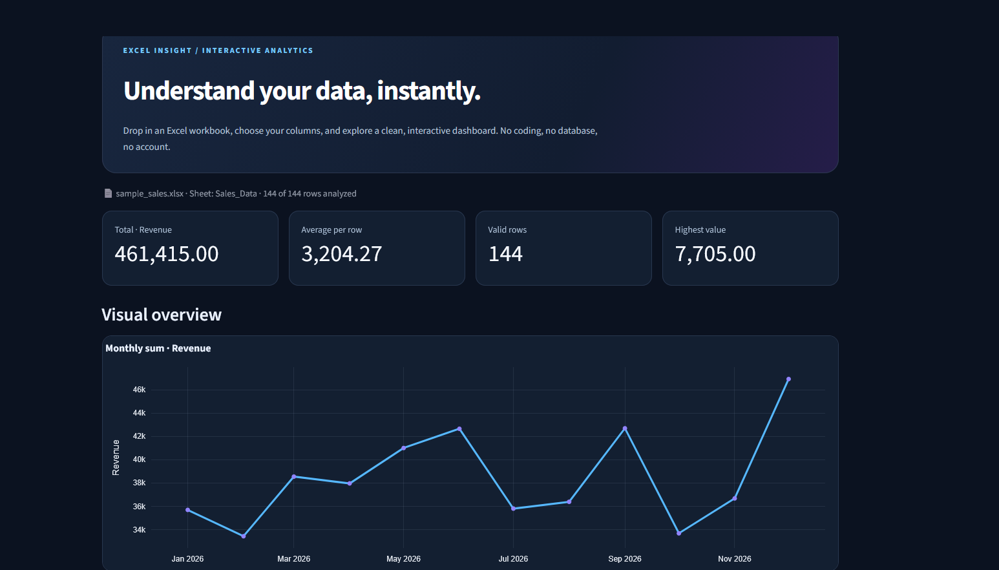

# Excel Insight Dashboard 📊

### 🚀 Live Demo


**Developed by Saman Farshad**

**Tech Stack:** Python | Streamlit | Pandas | Plotly | Data Analytics

A clean, interactive analytics web app built with Python, Streamlit, Pandas and Plotly. Explore three **preloaded, fictional** datasets, customize KPI cards and charts, apply filters, and export reports.

> **Public demo · No uploads.** This deployment intentionally does not accept Excel files, personal information, accounts, or user-generated data.

## Features

- **Three fictional demo datasets**: Sales performance, Factory quality, Website engagement
- **Built-in Excel workbooks** bundled with the app; users cannot upload their own files
- **4 KPIs**: total, average, valid row count, maximum
- **Up to 3 adaptive charts**: monthly trend, categories, distribution, or relationship/outliers
- **Simple controls**: measure, aggregation, categories, date range
- **Exports**: filtered sample workbook and interactive offline HTML report
- **No login, database, or external AI API** required

## Quick start (Windows / PowerShell)

```powershell
py -3.11 -m venv .venv
.\.venv\Scripts\Activate.ps1
python -m pip install -r requirements.txt
python -m streamlit run app.py
```

Open **http://localhost:8501**.

## Try the sample datasets

From the sidebar choose **Sales performance**, **Factory quality**, or **Website engagement**. They are generated fictional examples, not real customer or employee records. Charts and KPIs adapt to the measures you choose.

No user file input is accepted in the public demo. `app.py` selects a file exclusively from a hard-coded mapping of bundled datasets.

## Exports

- `excel_insight_filtered.xlsx`: filtered rows from the selected fictional dataset
- `excel_insight_report.html`: standalone interactive report based on fictional data; works offline

## Data handling and security scope

- **No file uploader** or user-supplied Excel ingestion on the public application.
- Workbooks are packaged with the project and load from fixed local paths.
- There is no authentication, external AI API, or application database.
- The sample data contain no real people's information.
- Public visitors can download demo data or offline reports.
- Streamlit hosting and infrastructure may still process technical access/usage data under their own policies. This demo design **reduces risk, but does not guarantee immunity from cyberattacks or legal obligations**.
- Keep Streamlit and dependencies updated. Consider applicable privacy notices and German website operator requirements separately.

The `.streamlit/config.toml` upload size cap is additional defense-in-depth, **not** the control that disables uploads; removing the upload widget and user-supplied file processing is the actual mitigation.

## Project structure

```text
Excel_Insight_Dashboard/
├── app.py                      # Demo-only Streamlit interface
├── analytics.py                # Filters, charts, exports
├── sample_data/
│   ├── sample_sales.xlsx       # Fictional data
│   ├── sample_factory.xlsx     # Fictional data
│   └── sample_website.xlsx     # Fictional data
├── .streamlit/
│   └── config.toml
├── screenshots/
│   ├── dashboard.png
│   └── dashboard.1.png
├── tests/
│   ├── test_analytics.py
│   └── test_demo_only.py
├── requirements.txt
├── .gitignore
└── README.md
```

## Dashboard Preview

### Main Dashboard



### Interactive Charts


*Screenshots show the same dashboard layout; the public version now offers only preloaded fictional data.*

## License

MIT
