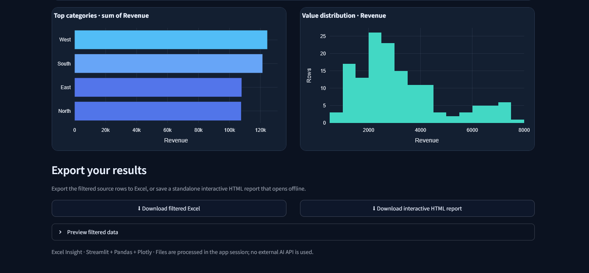

# Excel Insight Dashboard 📊
### 🚀 Live Demo

[**Launch Excel Insight Dashboard**](https://saman-excel-insight.streamlit.app)

**Developed by Saman Farshad**

**Tech Stack:** Python | Streamlit | Pandas | Plotly | Data Analytics

A clean, interactive analytics web app built with Python, Streamlit, Pandas and Plotly.

 Plotly**. Upload an Excel workbook, explore KPI cards and three charts, apply filters, then export the results. Designed as a compact, accessible alternative to building a full BI report for quick analysis.

## Features

- **Excel upload** (`.xlsx`) and worksheet selection
- **Instant preview** using the included fictional sales dataset
- **4 KPIs:** total, average, valid row count, maximum
- **Up to 3 adaptive charts:** monthly trend, top categories, value distribution, or relationship/outlier view
- **Simple filters:** category and date range
- **Exports:** filtered Excel workbook and offline, interactive HTML report
- No account, database, or AI API required

## Quick start (Windows / PowerShell)

```powershell
py -3.11 -m venv .venv
.\.venv\Scripts\Activate.ps1
python -m pip install -r requirements.txt
streamlit run app.py
```

The local app opens at **http://localhost:8501**.

## Try the included sample

Launch the app and leave **Explore with sample data** enabled. You'll see 2026 sales results, generated for demonstration and **not** real customer information. Then upload your own `.xlsx` file to replace it.

### Recommended Excel structure

One header row, one observation per row. Example:

| Date | Region | Category | Revenue | Profit |
|---|---|---|---:|---:|
| 2026-01-15 | North | Software | 1900 | 420 |
| 2026-01-16 | South | Hardware | 850 | 160 |

Numeric columns should contain Excel numbers rather than strings like `"1,900 EUR"`. The app looks for a date column using Excel date cells or a date-related column name. A date field is optional; the dashboard adapts if none exists.

## Exports

- `excel_insight_filtered.xlsx` — all filtered source rows, without internal helper fields.
- `excel_insight_report.html` — self-contained interactive charts that can be opened in a browser even without internet access. Treat it as a data-containing document; share it only when appropriate.

## Project structure

```text
Excel_Insight_Dashboard/
├── app.py                 # Streamlit interface
├── analytics.py           # Data preparation, filters, charts and exports
├── sample_data/
│   └── sample_sales.xlsx  # Fictional demo workbook
├── .streamlit/
│   └── config.toml        # Dark theme
├── tests/
│   └── test_analytics.py  # Unit tests
├── requirements.txt
├── .gitignore
└── README.md
```

## Data handling and limitations

Excel data is read in the Streamlit process. If run on your own laptop, it stays within that process. **Deploying to a cloud host means uploaded data is processed by that host**. No external AI API is called. Exported HTML reports contain the analyzed values in embedded chart data. This is a lightweight analyst dashboard, not a replacement for Power BI's modeling or enterprise access controls.

Supported uploads: `.xlsx` up to 50 MB (configured in `.streamlit/config.toml`). Only numeric measures can be analyzed. Very large workbooks may require a larger server. For date columns stored as ambiguous text, convert them into Excel date cells for reliable parsing.

## Screenshots

After running the app, save a screenshot into an `assets/` folder and reference it here as part of your GitHub portfolio.

## License

MIT

## Dashboard Preview

### Main Dashboard


### Interactive Charts
